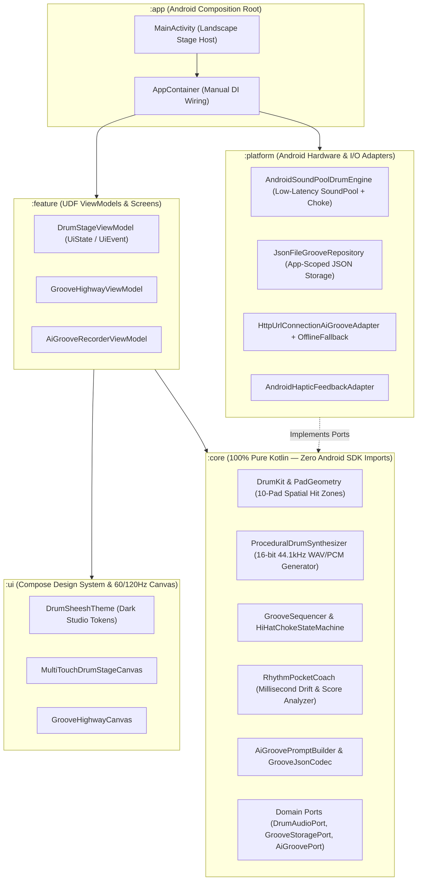

# 🏗️ System Architecture — Drum Sheesh

> **Stack Pack:** `android-kotlin-compose` (Phase 1 Priority: Native Android Phone & Tablet) + Phase 2 Web Companion (`web/`)  
> **Architecture Pattern:** Layered MVVM / UDF with Pure-Kotlin Core ("Portable Core, Platform Shell")  
> **Last Updated:** 2026-11-10

---

## 1. High-Level Topology & Mobile + Web Sharing Strategy

**Drum Sheesh** uses a **5-Module Android Architecture** where `:core` is **100% pure Kotlin (`kotlin("jvm")`) with zero Android imports**. This guarantees:
1. All musical, spatial, audio-synthesis, timing-scoring, and AI schema logic runs in sub-second JVM unit tests (`./gradlew :core:test`).
2. **Phase 1 (Mobile/Tablet Priority)** wraps `:core` in a native Android `:platform` + Jetpack Compose `:ui`/`:feature` shell with `<10ms` `SoundPool` audio and multi-touch `pointerInput`.
3. **Phase 2 (Web Studio Companion)** reuses the exact same `:core` domain contracts (either via Kotlin Multiplatform `wasmJs`/`js` compilation of `:core` or 1:1 shared JSON groove/synth contracts in `web/`).



---

## 2. Repository & Module Structure

```text
drum-sheesh/
├── AGENTS.md                                  # Root Agent Brain & Critical Constraints
├── CLAUDE.md                                  # @AGENTS.md pointer
├── settings.gradle.kts                        # Includes :app, :core, :ui, :platform, :feature
├── build.gradle.kts                           # Root Gradle Kotlin DSL + checkMergedManifestPermissions task
├── gradle.properties                          # AndroidX, Kotlin 2.x, non-transitive R classes
├── docs/
│   ├── INDEX.md
│   ├── foundation/                            # prd.md, architecture.md, tech-stack.md, design-system.md, decisions.md
│   ├── planning/                              # roadmap.md, backlog.md, issues.md, history.md
│   └── specs/                                 # 00-scaffold, 01-drum-kit-stage, 02-groove-highway-coach, 03-ai-groove-recorder
├── core/                                      # Pure Kotlin JVM module (ZERO android.* imports)
│   └── src/
│       ├── main/kotlin/com/drumsheesh/core/
│       │   ├── model/                         # DrumPadId, DrumKitPreset, PadHitZone, PadHitEvent, GroovePattern, RecordedSession
│       │   ├── audio/                         # ProceduralDrumSynthesizer (generates Riff WAV byte arrays for all 10 pads x 4 kits)
│       │   ├── engine/                        # PadHitResolver, HiHatChokeTracker, GrooveTimelineCalculator, LoopQuantizer
│       │   ├── coach/                         # RhythmPocketCoach (drift ms, rushing/dragging classification, limb score)
│       │   ├── ai/                            # AiGroovePromptBuilder, GrooveJsonSerializer, ProceduralGrooveGenerator
│       │   └── port/                          # DrumAudioPort, GrooveRepositoryPort, AiGrooveGeneratorPort, ClockPort
│       └── test/kotlin/com/drumsheesh/core/   # Fast JUnit 5 / Kotlin Test unit & invariant suites
├── ui/                                        # Reusable Jetpack Compose theme, tokens & custom Canvas primitives
│   └── src/main/kotlin/com/drumsheesh/ui/
│       ├── theme/                             # Color.kt, Type.kt, Theme.kt, StudioTokens.kt
│       └── components/                        # DrumPadSurface.kt, GrooveHighwayRenderer.kt, StudioTopBar.kt, VelocityMeter.kt
├── platform/                                  # Android SDK implementations of :core ports
│   └── src/main/kotlin/com/drumsheesh/platform/
│       ├── audio/                             # SoundPoolDrumAudioAdapter.kt (writes synthesized WAVs to cache & loads SoundPool)
│       ├── storage/                           # FileGrooveRepositoryAdapter.kt (persists custom grooves & recorded takes)
│       └── ai/                                # GeminiAiGrooveAdapter.kt (HTTPS Gemini JSON call + offline procedural fallback)
├── feature/                                   # Feature UDF ViewModels, UiState/UiEvent & Screen Composables
│   └── src/
│       ├── main/kotlin/com/drumsheesh/feature/
│       │   ├── stage/                         # DrumStageViewModel.kt, DrumStageScreen.kt (Feature 01)
│       │   ├── highway/                       # GrooveHighwayViewModel.kt, GrooveHighwaySheet.kt, PocketCoachDialog.kt (Feature 02)
│       │   └── recorder/                      # AiGrooveRecorderViewModel.kt, AiPromptModal.kt, LoopDrawer.kt (Feature 03)
│       └── test/kotlin/com/drumsheesh/feature/# ViewModel UDF state transition unit tests
└── app/                                       # Android Application shell & manifest
    └── src/main/
        ├── AndroidManifest.xml                # Landscape sensorLandscape activity + strict permission allowlist
        └── kotlin/com/drumsheesh/app/
            ├── DrumSheeshApplication.kt
            ├── AppContainer.kt                # Manual dependency injection container
            └── MainActivity.kt                # Full-screen immersive stage host
```

---

## 3. Core Domain Data Models (`:core`)

### 3.1 `DrumPadId` & 10-Pad Kit Layout
| Pad ID | Default Keyboard Key (Web/Desktop) | Acoustic Role | Choke Group |
|--------|------------------------------------|---------------|-------------|
| `CRASH` | `Y` | 16" Crash Cymbal (Top-Left) | None |
| `RIDE` | `U` | 20" Ride Cymbal (Top-Right) | None |
| `HI_HAT_OPEN` | `E` | Open Hi-Hat (Mid-Left Outer) | Emits to `HI_HAT_GROUP` |
| `HI_HAT_CLOSED` | `R` | Closed Hi-Hat (Mid-Left Inner) | **Chokes `HI_HAT_OPEN`** |
| `TOM_HIGH` | `G` | 10" High Rack Tom (Upper Center-Left) | None |
| `TOM_MID` | `H` | 12" Mid Rack Tom (Upper Center-Right) | None |
| `TOM_FLOOR` | `J` | 16" Floor Tom (Lower Right) | None |
| `SNARE` | `F` / `D` | 14" Studio Snare (Lower Center-Left) | None |
| `KICK_LEFT` | `C` / `Space` | Double-Bass Left Kick Pedal (Bottom Left) | None |
| `KICK_RIGHT` | `V` / `B` | Primary Right Kick Pedal (Bottom Right) | None |

### 3.2 `GroovePattern` & `RecordedLoop` JSON Schema (Shared Between Android & Phase 2 Web)
```json
{
  "id": "groove-boom-bap-92",
  "title": "92 BPM Neo-Soul Boom Bap",
  "bpm": 92,
  "swingPercent": 18,
  "stepsPerBar": 16,
  "bars": 2,
  "kitId": "vintage-breakbeat",
  "steps": [
    { "stepIndex": 0, "padId": "KICK_RIGHT", "velocity": 0.95 },
    { "stepIndex": 0, "padId": "HI_HAT_CLOSED", "velocity": 0.75 },
    { "stepIndex": 4, "padId": "SNARE", "velocity": 0.90 }
  ]
}
```

---

## 4. Key Data Flows

### 4.1 Ultra-Low-Latency Multi-Touch Hit Flow (`<10ms`)
1. User touches 1 to 8 fingers simultaneously on `MultiTouchDrumStageCanvas` (`:ui`).
2. `awaitEachGesture` inspects `PointerEventPass.Initial` for any pointer that `changedToDownIgnoreConsumed()` (or slid across a pad boundary during a drum roll).
3. Normalized coordinates `(xNorm, yNorm)` in `[0f..1f]` are passed to `PadHitResolver.resolveHit(xNorm, yNorm, isLeftHanded)` in `:core`, returning `PadHitResult(padId, velocity)`. Velocity is calculated from radial distance to the pad center (`1.0f` dead-center → `0.45f` outer rim).
4. `DrumStageViewModel` immediately calls `drumAudioPort.triggerPad(kitId, padId, velocity)` on the main/audio-fast path and updates visual hit ripple state.
5. `SoundPoolDrumAudioAdapter` plays the pre-loaded PCM buffer in `SoundPool`. If `padId == HI_HAT_CLOSED`, it calls `soundPool.stop(activeOpenHiHatStreamId)` immediately.

### 4.2 Rhythm Pocket Coach Evaluation Flow
1. While a `GroovePattern` is active on the Groove Highway, each expected step has a target timestamp `expectedTimeMs`.
2. Every user pad hit records `ActualHit(padId, actualTimeMs, velocity)`.
3. `RhythmPocketCoach.evaluate(expectedHits, actualHits)` matches hits within a `±120ms` window per pad, computing:
   - `deltaMs = actualTimeMs - expectedTimeMs` (negative = early/rushing, positive = late/dragging)
   - Classification: `PERFECT` (`|deltaMs| <= 20ms`), `GOOD` (`<= 45ms`), `EARLY`/`LATE` (`<= 90ms`), `MISS` (`> 90ms`)
   - Aggregate `pocketScore` (`0..100`), `meanDriftMs`, `tendency` (`LOCKED_IN`, `RUSHING`, `DRAGGING`), and a 2-sentence coaching summary.
