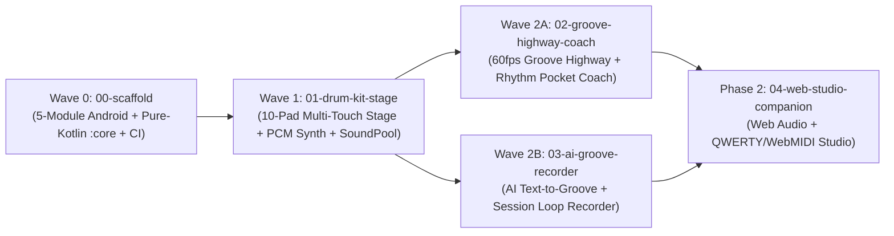

# 🗺️ Project Roadmap & Feature Dependency Matrix — Drum Sheesh

> **Project:** Drum Sheesh (`drum-sheesh`)  
> **Primary Stack:** `android-kotlin-compose` (Phase 1 Mobile/Tablet Priority) + Phase 2 Web Companion (`web/`)  
> **Last Updated:** 2026-11-10

---

## 1. Macro Phase Overview

- **Phase 0: Foundation Scaffold (`00-scaffold`)** — Multi-module Gradle Kotlin DSL setup (`:app`, `:core`, `:ui`, `:platform`, `:feature`), Manifest Permission Allowlist Guard (`checkMergedManifestPermissions`), pure-Kotlin `:core` boundary verification, and GitHub Actions CI.
- **Phase 1: Android Mobile & Tablet MVP (Priority)**
  - **Wave 1 (`01-drum-kit-stage`):** 10-Pad Multi-Touch Drum Stage, Pure-Kotlin Procedural 16-Bit PCM Synthesizer (4 studio kits), Low-Latency Android `SoundPool` adapter, Hi-Hat Choke state machine, Radial Velocity & Left/Right-Handed flip.
  - **Wave 2 (`02-groove-highway-coach` & `03-ai-groove-recorder`):**
    - `02-groove-highway-coach`: Interactive 60/120fps Groove Highway, Built-in Genre Lessons, BPM/Swing Metronome, and **Rhythm Pocket Coach** (millisecond hit-drift & rushing/dragging analysis).
    - `03-ai-groove-recorder`: **AI Text-to-Groove Generator** (Gemini structured JSON + offline procedural groove generator) and **Multi-Take Session Recorder** with `1/16` quantization and loop playback.
- **Phase 2: Web Studio Companion & Pro Ecosystem (`04-web-studio-companion`)**
  - Browser-based Web Studio (`web/`) reusing `:core` groove/synth logic for Desktop QWERTY keyboard, WebMIDI controllers, and mobile PWA browsers.
  - Custom WAV sample import & multi-stem export.

---

## 2. Feature Specs Registry & Dependency Matrix (`docs/specs/`)

| Wave | ID | Feature Slug | Spec Bundle | Depends On | Touches (Isolation Zone) | Status | Branch / Owner |
|------|----|--------------|-------------|------------|--------------------------|--------|----------------|
| `Wave 0` | `00` | `00-scaffold` | [`docs/specs/00-scaffold/`](../specs/00-scaffold/tasks.md) | None | `settings.gradle.kts, build.gradle.kts, core/, ui/, platform/, feature/, app/, .github/workflows/ci.yml` | `[x]` | `main` |
| `Wave 1` | `01` | `01-drum-kit-stage` | [`docs/specs/01-drum-kit-stage/`](../specs/01-drum-kit-stage/tasks.md) | `00` | `core/model/, core/audio/, core/engine/, platform/audio/, ui/components/DrumPadSurface.kt, feature/stage/` | `[x]` | `feat/phase-1` |
| `Wave 2` | `02` | `02-groove-highway-coach` | [`docs/specs/02-groove-highway-coach/`](../specs/02-groove-highway-coach/tasks.md) | `01` | `core/coach/, ui/components/GrooveHighwayRenderer.kt, feature/highway/` | `[x]` | `feat/phase-1` |
| `Wave 2` | `03` | `03-ai-groove-recorder` | [`docs/specs/03-ai-groove-recorder/`](../specs/03-ai-groove-recorder/tasks.md) | `01` | `core/ai/, platform/ai/, platform/storage/, feature/recorder/` | `[x]` | `feat/phase-1` |
| `Phase 2` | `04` | `04-web-studio-companion` | *(Phase 2 — `/spec 04-web-studio-companion`)* | `01, 02, 03` | `web/` | `[-]` | `feat/04-web-studio-companion` |

---

## 3. Mermaid Dependency Wave Graph

