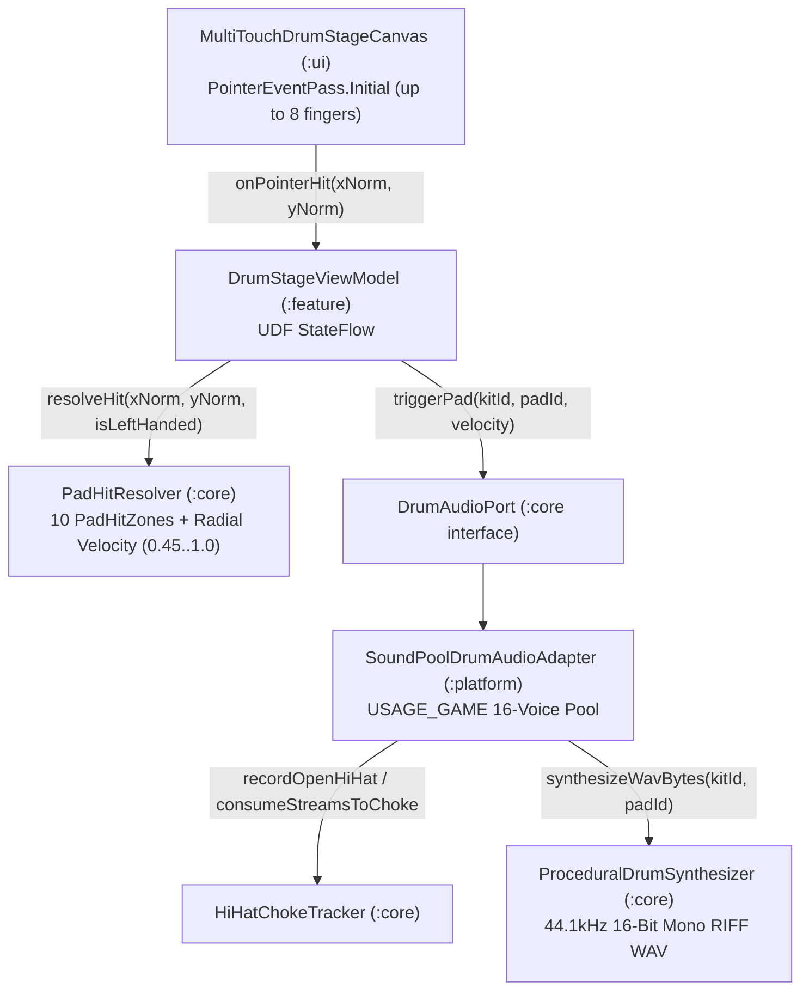

# 📐 Technical Design: Multi-Touch Drum Stage & Low-Latency Audio Engine (`01-drum-kit-stage`)

> **Feature Slug:** `01-drum-kit-stage` · **Requirements:** [`requirements.md`](./requirements.md)  
> **Visual Reference:** [`./design-reference/stitch-prompt.md`](./design-reference/stitch-prompt.md) & [`docs/foundation/design-system.md`](../../foundation/design-system.md)  
> **Blast Radius:** `🟢 ISOLATED` (Establishes foundational 10-pad geometry, PCM synth, SoundPool adapter, and Drum Stage UI)

---

## 1. Architecture & Data Flow

`01-drum-kit-stage` implements the core interactive drum instrument across all 5 modules while maintaining 100% pure-Kotlin portability in `:core`:
1. **Pure-Kotlin Domain (`:core`):**
   - `PadHitResolver` defines the 10 spatial `PadHitZone` definitions in normalized `[0f..1f]` stage coordinates, supports horizontal mirroring (`1f - x`) when Left-Handed mode is enabled, and computes dynamic radial velocity (`0.45f..1.0f`) from center proximity.
   - `HiHatChokeTracker` tracks active `HI_HAT_OPEN` stream IDs and returns streams to choke whenever `HI_HAT_CLOSED` is triggered.
   - `ProceduralDrumSynthesizer` deterministically synthesizes 44.1kHz 16-bit mono RIFF WAV byte arrays for all 10 `DrumPadId` pads across all 4 `DrumKitId` studio presets (*Acoustic Studio*, *808 Trap*, *Vintage Breakbeat*, *Synthwave Electronic*).
2. **Android Platform Audio (`:platform`):**
   - `SoundPoolDrumAudioAdapter` writes the synthesized WAV buffers into `context.cacheDir/drum_kits/<kitId>/<padId>.wav`, loads them into a low-latency `SoundPool` (`USAGE_GAME`, `CONTENT_TYPE_SONIFICATION`, 16 max streams), chokes active open hi-hat streams via `HiHatChokeTracker`, and silences streams on `Lifecycle.Event.ON_STOP`.
   - `AndroidHapticFeedbackAdapter` provides crisp haptic feedback on pad down-events.
3. **Jetpack Compose Stage Canvas & UDF (`:ui`, `:feature`, `:app`):**
   - `MultiTouchDrumStageCanvas` and `StudioTopBar` in `:ui` track up to 8 simultaneous pointers on `PointerEventPass.Initial` (`changedToDownIgnoreConsumed()` + slide-to-roll boundary crossings) and render pad shells, labels, velocity ripples, and hi-hat choke rings with zero per-frame allocations inside `Canvas`.
   - `DrumStageViewModel` and `DrumStageScreen` in `:feature` manage `StateFlow<DrumStageUiState>` (active kit, left-handed toggle, BPM, active pad ripples, last velocity, choke flash) and dispatch audio triggers.

---

## 2. File Placement, Component Interfaces & Visual Mapping

> Strictly follows `docs/foundation/architecture.md` and `.agents/rules/stack-rules.md` layer boundaries.

| Action | Exact File Path | Layer | Responsibility & Visual Reference (`design-reference/`) | Validates |
| :--- | :--- | :--- | :--- | :--- |
| `[NEW]` | `core/src/main/kotlin/com/drumsheesh/core/engine/PadHitResolver.kt` | `[BE]` Core | `PadHitZone`, `PadHitResult`, `PadHitResolver` (10-pad spatial hit resolution, radial velocity `0.45f..1.0f`, left-handed X-mirroring), and `HiHatChokeTracker` | `Req 1.1, 1.2, 2.2, 2.3` |
| `[NEW]` | `core/src/main/kotlin/com/drumsheesh/core/audio/ProceduralDrumSynthesizer.kt` | `[BE]` Core | Pure-Kotlin 44.1kHz 16-bit mono RIFF WAV generator for all 10 pads × 4 studio kits | `Req 2.1` |
| `[NEW]` | `core/src/test/kotlin/com/drumsheesh/core/engine/PadHitAndSynthTest.kt` | `[BE]` Test | Unit & invariant tests for RIFF WAV headers, RMS energy across all 40 kit-pad combinations, radial velocity bounds, left-handed mirroring, and hi-hat choke tracking | `Req 1.1, 2.1, 2.2, 2.3` |
| `[NEW]` | `platform/src/main/kotlin/com/drumsheesh/platform/audio/SoundPoolDrumAudioAdapter.kt` | `[BE]` Platform | Android `SoundPool` (`USAGE_GAME`) implementation of `DrumAudioPort` with `DefaultLifecycleObserver` (`onStop` silence), WAV cache writing, hi-hat stream choking, and `AndroidHapticFeedbackAdapter` | `Req 1.1, 2.1, 2.2` |
| `[NEW]` | `ui/src/main/kotlin/com/drumsheesh/ui/components/DrumPadSurface.kt` | `[FE]` UI | `StudioTopBar` and `MultiTouchDrumStageCanvas` with `PointerEventPass.Initial` multi-touch down-event + slide-to-roll detection and zero-allocation Canvas rendering | `Req 1.1, 1.2, 1.3, 2.3` |
| `[NEW]` | `feature/src/main/kotlin/com/drumsheesh/feature/stage/DrumStageScreen.kt` | `[FE]` Feature | `DrumStageUiState`, `DrumStageUiEvent`, `PadVisualRipple`, `DrumStageViewModel`, and `DrumStageScreen` | `Req 1.1, 2.2, 2.3` |
| `[NEW]` | `feature/src/test/kotlin/com/drumsheesh/feature/stage/DrumStageViewModelTest.kt` | `[FE]` Test | UDF ViewModel unit tests verifying multi-touch hit resolution, audio port triggering, hi-hat choke state updates, kit switching, and left-handed mirroring | `Req 1.1, 2.2, 2.3` |
| `[MODIFY]` | `feature/src/main/kotlin/com/drumsheesh/feature/DrumSheeshRootHost.kt` | `[FE]` Feature | Mounts `DrumStageScreen` as the primary landscape stage | `Req 1.1` |
| `[MODIFY]` | `app/src/main/kotlin/com/drumsheesh/app/AppContainer.kt` | `[BE]` App DI | Wires `SoundPoolDrumAudioAdapter` into manual DI container | `Req 1.1, 2.1` |
| `[MODIFY]` | `app/src/main/kotlin/com/drumsheesh/app/MainActivity.kt` | `[FE]` App Host | Registers lifecycle observer for `SoundPoolDrumAudioAdapter` and passes dependencies to `DrumSheeshRootHost` | `Req 1.1, 2.2` |

---

## 3. Data Models & Domain Contracts

### Core Spatial & Choke Models (`PadHitResolver.kt`)
| Model / Method | Signature / Fields | Constraints & Notes |
| :--- | :--- | :--- |
| `PadHitZone` | `padId: DrumPadId, centerX: Float, centerY: Float, radiusX: Float, radiusY: Float, isCircular: Boolean, isAsymmetrical: Boolean` | Normalized `[0f..1f]` coordinates on the landscape stage |
| `PadHitResult` | `padId: DrumPadId, velocity: Float, normalizedX: Float, normalizedY: Float, isChokeTrigger: Boolean` | `velocity` clamped to `[0.45f..1.0f]` (`1.0f` at dead center, `0.45f` at outer rim) |
| `PadHitResolver.resolveHit` | `fun resolveHit(xNorm: Float, yNorm: Float, isLeftHanded: Boolean = false): PadHitResult?` | Mirrors asymmetrical zones via `effectiveCenterX = if (isLeftHanded && zone.isAsymmetrical) 1f - zone.centerX else zone.centerX` |
| `HiHatChokeTracker` | `recordOpenHiHatStream(streamId: Int)`, `onPadTriggered(padId: DrumPadId): List<Int>` | Returns active `HI_HAT_OPEN` stream IDs and clears them when `HI_HAT_CLOSED` is triggered |

### Procedural PCM WAV Contract (`ProceduralDrumSynthesizer.kt`)
- **Sample Rate:** `44100 Hz`, Mono (`1` channel), `16-bit` signed little-endian PCM
- **Header:** Standard 44-byte RIFF/WAVE header (`"RIFF"`, file size, `"WAVE"`, `"fmt "`, `"data"`)
- **Kits Supported:** `ACOUSTIC_STUDIO`, `TRAP_808`, `VINTAGE_BREAKBEAT`, `SYNTHWAVE_ELECTRONIC` across all 10 `DrumPadId` values (40 distinct synthesized samples).

---

## 4. Error Handling Matrix

| Category | Trigger | System Response | Audio / State Mutation? | UI Behavior | Validates |
| :--- | :--- | :--- | :--- | :--- | :--- |
| `dead_zone_touch` | Pointer touches empty floor space outside all 10 `PadHitZone` regions or out-of-bounds `<0f` / `>1f` | `PadHitResolver.resolveHit` returns `null` | No audio triggered, no ripple added | Stage ignores floor tap cleanly | `Req 1.1` |
| `same_pad_drag` | Pointer moves within the *same* `PadHitZone` without crossing into a new pad | Pointer tracker compares current `DrumPadId` against pointer's last active `DrumPadId` | Suppresses duplicate re-trigger on micro-jitter; only triggers on new pad entry | Smooth slide-to-roll across distinct pads | `Req 1.2` |
| `lifecycle_background` | App transitions to `ON_STOP` while cymbals/pads are ringing | `SoundPoolDrumAudioAdapter.onStop` invokes `stopAllStreams()` and clears `HiHatChokeTracker` | All active streams stopped immediately | Active visual ripples cleared safely | `Req 2.2` |
| `bpm_bounds` | User increments/decrements BPM beyond `[40..240]` | `DrumStageViewModel` clamps BPM to `40..240` | State clamped to valid range | BPM counter stays within `40..240 BPM` | `Req 1.1` |

---

## 5. Correctness Properties & Verification Strategy

### Correctness Properties (Invariants)
- **Property 1 (Valid RIFF WAV & Non-Zero Acoustic Energy):** *For all* 4 `DrumKitId` presets and *all* 10 `DrumPadId` values (40 combinations), `ProceduralDrumSynthesizer.synthesizeWavBytes(kitId, padId)` SHALL return a byte array starting with `"RIFF"` and `"WAVE"` headers and containing non-zero 16-bit PCM RMS amplitude. *(Validates: `Req 2.1`)*
- **Property 2 (Radial Velocity Bounds & Left-Handed Symmetry):** *For any* hit coordinate inside a `PadHitZone`, `PadHitResolver.resolveHit` SHALL return a velocity strictly within `[0.45f..1.0f]` where dead-center hits yield `1.0f`, and toggling `isLeftHanded = true` SHALL resolve the exact mirrored hit at `(1f - x, y)`. *(Validates: `Req 1.1, 2.3`)*
- **Property 3 (Deterministic Hi-Hat Choke):** *For any* sequence of `HI_HAT_OPEN` stream activations followed by a `HI_HAT_CLOSED` trigger, `HiHatChokeTracker` SHALL return all active open hi-hat stream IDs for immediate termination and empty its active set. *(Validates: `Req 2.2`)*

### Verification Commands
- **Core JVM Unit Tests:** `./gradlew :core:test`
- **Full Android Compile, Unit Tests & Manifest Guard:** `./gradlew compileDebugKotlin testDebugUnitTest checkMergedManifestPermissions`
