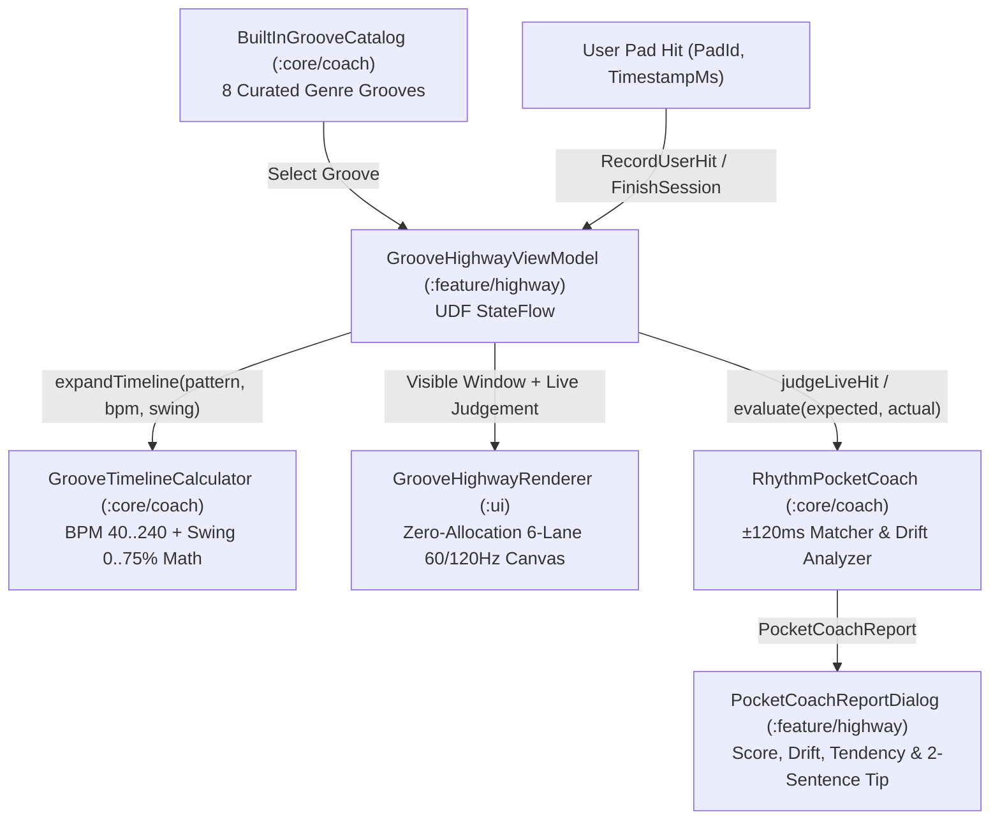

# 📐 Technical Design: Interactive Groove Highway & Rhythm Pocket Coach (`02-groove-highway-coach`)

> **Feature Slug:** `02-groove-highway-coach` · **Requirements:** [`requirements.md`](./requirements.md)  
> **Visual Reference:** [`./design-reference/stitch-prompt.md`](./design-reference/stitch-prompt.md) & [`docs/foundation/design-system.md`](../../foundation/design-system.md)  
> **Blast Radius:** `🟢 ISOLATED` (Confined strictly to `core/coach/`, `ui/components/GrooveHighwayRenderer.kt`, and `feature/highway/`)

---

## 1. Architecture & Data Flow

`02-groove-highway-coach` adds the interactive rhythm trainer, built-in genre groove catalog, BPM/swing timeline engine, 60/120fps Groove Highway Canvas, and post-session Rhythm Pocket Coach analytics:
1. **Pure-Kotlin Domain (`:core/coach/`):**
   - `BuiltInGrooveCatalog` provides 8 curated multi-bar genre `GroovePattern` presets (*Classic Rock Backbeat*, *92 BPM Neo-Soul Boom Bap*, *140 BPM Trap Hi-Hat Roll*, *Funk Ghost-Note Pocket*, *Pop-Punk Double Time*, *Heavy Metal Double Kick*, *Four-on-the-Floor House*, *Bossa Nova Clave*).
   - `GrooveTimelineCalculator` computes exact target timestamps (`expectedTimeMs`) for each step across one or more loop passes, clamping `bpm` to `[40..240]` and `swingPercent` to `[0..75]` (delaying odd 16th-note offbeats deterministically).
   - `RhythmPocketCoach` matches user `ActualPadHit` timestamps against `ScheduledGrooveStep` targets within a `±120ms` window per pad, classifying each hit (`PERFECT` `<=20ms`, `GOOD` `21..45ms`, `EARLY`/`LATE` `46..90ms`, `MISS` `>90ms` or unmatched) and generating a `PocketCoachReport` (`pocketScore` `0..100`, signed `meanDriftMs`, `LOCKED_IN`/`RUSHING`/`DRAGGING` tendency, weakest pad breakdown, and a deterministic 2-sentence drill tip).
2. **Jetpack Compose 60/120fps Highway Canvas (`:ui`):**
   - `GrooveHighwayRenderer` renders the collapsible 6-lane scrolling note highway (`KICK`, `SNARE`, `CLOSED HH`, `OPEN HH`, `TOMS`, `CYMBALS`), the `#FBBF24` vertical Now-Line, and the live `HitJudgement` pill (`PERFECT -4ms`, `GOOD +28ms`, `EARLY -54ms`, `LATE +62ms`, `MISS`) with zero per-frame object allocations inside `Canvas`.
3. **Feature UDF ViewModel & Coach Dialog (`:feature/highway/`):**
   - `GrooveHighwayViewModel` manages `StateFlow<GrooveHighwayUiState>`, coordinates groove selection, BPM (`40..240`) and Swing (`0..75%`) adjustments, playhead progression via `ClockPort`, live pad hit scoring, and the `PocketCoachReportDialog` modal (including `"Retry Groove"` and `"Slow Tempo -10 BPM"` actions).

---

## 2. File Placement, Component Interfaces & Visual Mapping

> Strictly follows `docs/foundation/architecture.md`, `.agents/rules/stack-rules.md`, and the feature's `Touches` isolation boundaries.

| Action | Exact File Path | Layer | Responsibility & Visual Reference (`design-reference/`) | Validates |
| :--- | :--- | :--- | :--- | :--- |
| `[NEW]` | `core/src/main/kotlin/com/drumsheesh/core/coach/GrooveTimelineCalculator.kt` | `[BE]` Core | `GrooveStep`, `GroovePattern`, `ScheduledGrooveStep`, `BuiltInGrooveCatalog` (8 genre grooves), and `GrooveTimelineCalculator` (BPM `40..240` & swing `0..75%` 16th-note offset math) | `Req 1.1, 1.2` |
| `[NEW]` | `core/src/main/kotlin/com/drumsheesh/core/coach/RhythmPocketCoach.kt` | `[BE]` Core | `HitClassification`, `TimingTendency`, `ActualPadHit`, `HitJudgement`, `PadAccuracyBreakdown`, `PocketCoachReport`, and `RhythmPocketCoach` (`±120ms` matcher, drift & tendency scorer, weakest-pad 2-sentence tip) | `Req 1.3, 2.1, 2.2` |
| `[NEW]` | `core/src/test/kotlin/com/drumsheesh/core/coach/RhythmPocketCoachTest.kt` | `[BE]` Test | Unit & invariant tests for 8-groove catalog, swing timestamp math, millisecond drift classification, rushing/dragging tendency, and `0..100` score bounds | `Req 1.1, 1.2, 2.1, 2.2` |
| `[NEW]` | `ui/src/main/kotlin/com/drumsheesh/ui/components/GrooveHighwayRenderer.kt` | `[FE]` UI | 6-lane scrolling `GrooveHighwayRenderer` Canvas, Now-Line hit flash, and live `HitJudgement` pill (`stitch-prompt.md` Screen 1) with zero per-frame allocations | `Req 1.3` |
| `[NEW]` | `feature/src/main/kotlin/com/drumsheesh/feature/highway/GrooveHighwayViewModel.kt` | `[FE]` Feature | `GrooveHighwayUiState`, `GrooveHighwayUiEvent`, `GrooveHighwayViewModel`, `GrooveHighwayControlPanel`, and `PocketCoachReportDialog` (`stitch-prompt.md` Screen 1) | `Req 1.1, 1.2, 1.3, 2.1, 2.2` |
| `[NEW]` | `feature/src/test/kotlin/com/drumsheesh/feature/highway/GrooveHighwayViewModelTest.kt` | `[FE]` Test | UDF ViewModel unit tests verifying groove switching, BPM/swing clamping, live hit judgement updates, coach report generation, and slow-tempo retry | `Req 1.1, 1.2, 1.3, 2.1, 2.2` |

---

## 3. Data Models & Domain Contracts

### Groove & Timeline Models (`GrooveTimelineCalculator.kt`)
| Model / Method | Signature / Fields | Constraints & Notes |
| :--- | :--- | :--- |
| `GrooveStep` | `stepIndex: Int, padId: DrumPadId, velocity: Float = 0.85f` | `stepIndex >= 0`, `velocity` in `0.1f..1.0f` |
| `GroovePattern` | `id: String, title: String, genre: String, bpm: Int, swingPercent: Int, stepsPerBar: Int = 16, bars: Int = 2, kitId: DrumKitId, steps: List<GrooveStep>` | Pure-Kotlin immutable sequence shared across presets and Phase 2 Web |
| `ScheduledGrooveStep` | `passIndex: Int, barIndex: Int, stepIndex: Int, padId: DrumPadId, velocity: Float, expectedTimeMs: Long` | Exact target timestamp in ms computed by `GrooveTimelineCalculator` |
| `GrooveTimelineCalculator.computeStepTimestampMs` | `fun computeStepTimestampMs(startTimeMs: Long, globalStepIndex: Int, bpm: Int, swingPercent: Int, stepsPerBar: Int = 16): Long` | Base 16th duration `= (60_000.0 / clampedBpm) / (stepsPerBar / 4.0)`. Odd steps (`globalStepIndex % 2 == 1`) add `baseStepDurationMs * (clampedSwing / 100.0)` |

### Rhythm Pocket Coach Models (`RhythmPocketCoach.kt`)
| Model / Method | Signature / Fields | Constraints & Notes |
| :--- | :--- | :--- |
| `HitClassification` | `enum class { PERFECT, GOOD, EARLY, LATE, MISS }` | `PERFECT` (`<=20ms`), `GOOD` (`21..45ms`), `EARLY` (`-90..-46ms`), `LATE` (`+46..+90ms`), `MISS` (`>90ms` or unmatched) |
| `TimingTendency` | `enum class { LOCKED_IN, RUSHING, DRAGGING }` | `RUSHING` if `meanDriftMs < -8`, `DRAGGING` if `meanDriftMs > +8`, else `LOCKED_IN` |
| `PocketCoachReport` | `pocketScore: Int, meanDriftMs: Int, tendency: TimingTendency, perfectCount: Int, goodCount: Int, earlyCount: Int, lateCount: Int, missCount: Int, judgements: List<HitJudgement>, perPadBreakdown: Map<DrumPadId, PadAccuracyBreakdown>, weakestPad: DrumPadId?, coachTip: String` | `pocketScore` clamped to `0..100`; `coachTip` always contains a deterministic 2-sentence actionable recommendation |

---

## 4. Error Handling Matrix

| Category | Trigger | System Response | Audio / State Mutation? | UI Behavior | Validates |
| :--- | :--- | :--- | :--- | :--- | :--- |
| `bpm_or_swing_out_of_bounds` | Caller passes `bpm < 40` or `> 240`, or `swingPercent < 0` or `> 75` | `GrooveTimelineCalculator` and `GrooveHighwayViewModel` coerce `bpm` to `40..240` and `swingPercent` to `0..75` | State clamped to valid range | HUD displays clamped BPM (`40..240 BPM`) and Swing (`0..75%`) | `Req 1.2` |
| `unmatched_or_late_hit` | User taps a pad `> 120ms` away from any expected step for that pad (or skips a step completely) | `RhythmPocketCoach` classifies the step/hit as `MISS` (`stepScore = 0`) and excludes unmatched hits from `meanDriftMs` | Recorded as `MISS` in `PocketCoachReport` | Highway flashes `MISS` pill in `#F38BA8` Coral Red | `Req 1.3, 2.1` |
| `empty_session_finish` | User taps **Finish & Coach** before hitting any pads | `RhythmPocketCoach.evaluate` scores all expected steps as `MISS` (`pocketScore = 0`, `meanDriftMs = 0`, `tendency = LOCKED_IN`) and returns a starter practice tip | Report generated safely without divide-by-zero | `PocketCoachReportDialog` displays `0 / 100` with starter guidance | `Req 2.1, 2.2` |
| `double_tap_same_step` | User taps the same pad twice within `±120ms` of a single expected step | Greedy closest-hit matcher claims the closest hit for that expected step; second hit cannot claim the same step twice | Prevents score inflation above `100` | Score remains strictly within `0..100` | `Req 2.1` |

---

## 5. Correctness Properties & Verification Strategy

### Correctness Properties (Invariants)
- **Property 1 (Genre Catalog Completeness & Swing Monotonicity):** `BuiltInGrooveCatalog.allGrooves` SHALL contain at least 8 distinct genre grooves with valid non-empty steps, and for any odd `stepIndex` (`stepIndex % 2 == 1`), increasing `swingPercent` in `0..75` SHALL monotonically increase `expectedTimeMs` while leaving even downbeat steps (`stepIndex % 2 == 0`) unchanged. *(Validates: `Req 1.1, 1.2`)*
- **Property 2 (Millisecond Drift Classification & Score Bounds):** For any set of expected steps and actual hits, `RhythmPocketCoach.evaluate` SHALL classify `|deltaMs| <= 20` as `PERFECT`, `21..45` as `GOOD`, `-90..-46` as `EARLY`, `+46..+90` as `LATE`, and `> 90` (or unmatched) as `MISS`, producing a `pocketScore` strictly within `0..100` and classifying `meanDriftMs < -8` as `RUSHING`, `> +8` as `DRAGGING`, and `-8..+8` as `LOCKED_IN`. *(Validates: `Req 1.3, 2.1`)*
- **Property 3 (Deterministic Weakest-Pad 2-Sentence Coaching Tip):** For every `PocketCoachReport`, `coachTip` SHALL be non-blank, reference the weakest pad's display name (when expected steps exist), and contain exactly 2 sentences of actionable timing guidance. *(Validates: `Req 2.2`)*

### Verification Commands
- **Core JVM Unit Tests:** `./gradlew :core:test`
- **Full Android Compile, Unit Tests & Manifest Guard:** `./gradlew compileDebugKotlin testDebugUnitTest checkMergedManifestPermissions`
