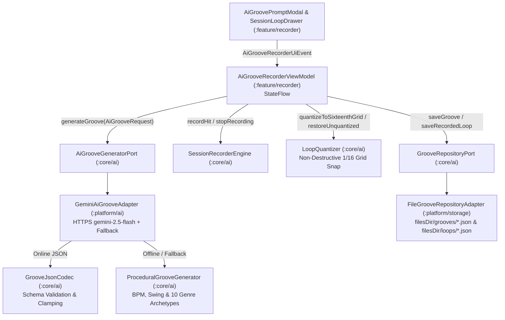

# 📐 Technical Design: AI Text-to-Groove Generator & Session Loop Recorder (`03-ai-groove-recorder`)

> **Feature Slug:** `03-ai-groove-recorder` · **Requirements:** [`requirements.md`](./requirements.md)  
> **Visual Reference:** [`./design-reference/stitch-prompt.md`](./design-reference/stitch-prompt.md) & [`docs/foundation/design-system.md`](../../foundation/design-system.md)  
> **Blast Radius:** `🟢 ISOLATED` (Self-contained within `:core/ai`, `:platform/ai`, `:platform/storage`, and `:feature/recorder`)

---

## 1. Architecture & Data Flow

`03-ai-groove-recorder` delivers two tightly integrated studio creation tools while preserving 100% pure-Kotlin portability in `:core`:
1. **AI Text-to-Groove Engine (`:core/ai` + `:platform/ai`):**
   - `AiGroovePromptBuilder` builds structured system and user prompts instructing Gemini `gemini-2.5-flash` to emit a JSON object conforming to `GroovePattern`.
   - `GrooveJsonCodec` parses and validates `GroovePattern` and `RecordedLoop` JSON payloads with zero third-party serialization dependencies, clamping `bpm` (`40..240`), `swingPercent` (`0..75`), `velocity` (`0.1f..1.0f`), and filtering/clamping `stepIndex` within `[0 until stepsPerBar * bars]`.
   - `ProceduralGrooveGenerator` provides deterministic, zero-latency offline groove generation from natural-language prompts by extracting BPM, swing percentage, kit hints, and 10 musical genre archetypes (*boom bap, trap, rock, metal, funk, house, dnb/amen break, jazz, punk, lofi*).
   - `GeminiAiGrooveAdapter` in `:platform` calls the Gemini HTTPS endpoint when an API key is configured and network is available, and seamlessly falls back to `ProceduralGrooveGenerator` whenever offline, unconfigured, or on any HTTP/parse failure.
2. **Multi-Take Session Recorder, Non-Destructive `1/16` Quantizer & Persistence (`:core/ai` + `:platform/storage` + `:feature/recorder`):**
   - `SessionRecorderEngine` captures live `RecordedHitEvent(padId, offsetMs, velocity)` events relative to recording start without requiring `RECORD_AUDIO` permission.
   - `LoopQuantizer` snaps recorded hit timestamps to the nearest `1/16`-note grid interval (accounting for `bpm` and `swingPercent` on odd 16th steps) while retaining `originalHits` for non-destructive undo.
   - `FileGrooveRepositoryAdapter` persists generated `GroovePattern` and `RecordedLoop` JSON files in app-scoped storage (`filesDir/grooves/` and `filesDir/loops/`).
   - `AiGrooveRecorderViewModel`, `AiGroovePromptModal`, and `SessionLoopDrawer` expose UDF state and dark-studio Compose UI components.

---

## 2. File Placement, Component Interfaces & Visual Mapping

> Strictly follows `docs/foundation/architecture.md` and `.agents/rules/stack-rules.md` layer boundaries and Wave 2 isolation zones.

| Action | Exact File Path | Layer | Responsibility & Visual Reference (`design-reference/`) | Validates |
| :--- | :--- | :--- | :--- | :--- |
| `[NEW]` | `core/src/main/kotlin/com/drumsheesh/core/ai/ProceduralGrooveGenerator.kt` | `[BE]` Core | `GrooveStep`, `GrooveSource`, `GroovePattern`, `AiGrooveRequest`, `AiGrooveGeneratorPort`, `GrooveRepositoryPort`, `AiGroovePromptBuilder`, `GrooveJsonCodec`, and `ProceduralGrooveGenerator` | `Req 1.1, 1.2, 2.3` |
| `[NEW]` | `core/src/main/kotlin/com/drumsheesh/core/ai/LoopQuantizer.kt` | `[BE]` Core | `RecordedHitEvent`, `RecordedLoop`, `SessionRecorderEngine`, and non-destructive `LoopQuantizer` (`1/16` grid snapping with swing support + loop-to-groove conversion) | `Req 2.1, 2.2` |
| `[NEW]` | `core/src/test/kotlin/com/drumsheesh/core/ai/AiGrooveAndQuantizerTest.kt` | `[BE]` Test | Unit & invariant tests for JSON round-trip serialization, BPM/swing/step clamping, prompt-to-genre parsing, session recording offsets, and non-destructive quantization | `Req 1.1, 1.2, 2.1, 2.2` |
| `[NEW]` | `platform/src/main/kotlin/com/drumsheesh/platform/ai/GeminiAiGrooveAdapter.kt` | `[BE]` Platform | Android HTTPS `gemini-2.5-flash` structured JSON adapter with automatic `ProceduralGrooveGenerator` fallback | `Req 1.1, 1.2` |
| `[NEW]` | `platform/src/main/kotlin/com/drumsheesh/platform/storage/FileGrooveRepositoryAdapter.kt` | `[BE]` Platform | App-scoped JSON file persistence (`filesDir/grooves/` and `filesDir/loops/`) implementing `GrooveRepositoryPort` | `Req 2.3` |
| `[NEW]` | `feature/src/main/kotlin/com/drumsheesh/feature/recorder/AiGrooveRecorderViewModel.kt` | `[FE]` Feature | `AiGrooveRecorderUiState`, `AiGrooveRecorderUiEvent`, `AiGrooveRecorderViewModel`, `AiGroovePromptModal`, and `SessionLoopDrawer` matching `design-reference/stitch-prompt.md` | `Req 1.1, 1.3, 2.1, 2.2, 2.3` |
| `[NEW]` | `feature/src/test/kotlin/com/drumsheesh/feature/recorder/AiGrooveRecorderViewModelTest.kt` | `[FE]` Test | ViewModel & persistence unit tests verifying `< 3` char prompt rejection, AI groove generation, live hit recording, `1/16` quantize/undo toggle, and disk persistence | `Req 1.1, 1.2, 1.3, 2.1, 2.2, 2.3` |

---

## 3. Data Models & Domain Contracts

### Core AI & Groove Models (`ProceduralGrooveGenerator.kt`)
| Model | Fields | Constraints & Validation Rules |
| :--- | :--- | :--- |
| `GrooveStep` | `stepIndex: Int, padId: DrumPadId, velocity: Float` | `stepIndex` in `[0 until stepsPerBar * bars]`; `velocity` clamped to `[0.1f..1.0f]` |
| `GroovePattern` | `id: String, title: String, bpm: Int, swingPercent: Int, stepsPerBar: Int, bars: Int, kitId: DrumKitId, steps: List<GrooveStep>, source: GrooveSource` | `bpm` clamped to `[40..240]`; `swingPercent` clamped to `[0..75]`; `stepsPerBar` default `16`; `bars` clamped to `[1..8]` |
| `AiGrooveRequest` | `prompt: String, targetKit: DrumKitId? = null` | `prompt.trim().length` must be in `3..200` |

### Session Recorder & Quantizer Models (`LoopQuantizer.kt`)
| Model | Fields | Constraints & Validation Rules |
| :--- | :--- | :--- |
| `RecordedHitEvent` | `padId: DrumPadId, offsetMs: Long, velocity: Float` | `offsetMs >= 0L` relative to recording start; `velocity` clamped to `[0.1f..1.0f]` |
| `RecordedLoop` | `id: String, title: String, bpm: Int, swingPercent: Int, bars: Int, kitId: DrumKitId, originalHits: List<RecordedHitEvent>, activeHits: List<RecordedHitEvent>, isQuantized: Boolean, createdAtMs: Long` | `originalHits` is immutable after recording stops; `activeHits` holds either quantized or unquantized hits |

---

## 4. Error Handling Matrix

| Category | Trigger | System Response | State / Storage Mutation? | UI Behavior | Validates |
| :--- | :--- | :--- | :--- | :--- | :--- |
| `validation_short_prompt` | User submits blank or `< 3` character prompt (or `> 200` chars) | `AiGrooveRecorderViewModel` rejects before calling `AiGrooveGeneratorPort` | No generator call, no file write | Inline error message shown in `AiGroovePromptModal`; user input preserved | `Req 1.3` |
| `ai_network_or_key_missing` | No Gemini API key configured, device offline, timeout, or non-200 HTTP response | `GeminiAiGrooveAdapter` catches exception and delegates to `ProceduralGrooveGenerator.generate(request)` | Valid fallback `GroovePattern` returned | Status pill shows `"Smart Studio Engine · Ready"` and pattern loads seamlessly | `Req 1.2` |
| `ai_malformed_json` | Gemini response contains malformed JSON or out-of-range BPM/step values | `GrooveJsonCodec` clamps out-of-range values or falls back to `ProceduralGrooveGenerator` if JSON is unparseable | Clamped/valid `GroovePattern` only | Validated pattern rendered in 16-step preview grid | `Req 1.1, 1.2` |
| `corrupt_saved_file` | A JSON file in `filesDir/grooves/` or `filesDir/loops/` is corrupted | `FileGrooveRepositoryAdapter` skips unreadable file during `loadSavedGrooves()` / `loadRecordedLoops()` | Other valid saved files load normally | Saved list renders all valid items without crashing | `Req 2.3` |

---

## 5. Correctness Properties & Verification Strategy

### Correctness Properties (Invariants)
- **Property 1 (Clamped & Validated AI Groove Output):** *For any* non-empty prompt (`3..200` chars) or raw JSON payload, `ProceduralGrooveGenerator` and `GrooveJsonCodec` SHALL produce a `GroovePattern` with `bpm in 40..240`, `swingPercent in 0..75`, non-empty `steps`, and every `stepIndex in 0 until (stepsPerBar * bars)`. *(Validates: `Req 1.1, 1.2`)*
- **Property 2 (Prompt Validation Gate):** *For any* prompt with trimmed length `< 3`, `AiGrooveRecorderViewModel` SHALL set a non-null `promptValidationError` and make `0` invocations to `AiGrooveGeneratorPort`. *(Validates: `Req 1.3`)*
- **Property 3 (Non-Destructive 1/16 Quantization Round-Trip):** *For any* `RecordedLoop`, applying `LoopQuantizer.quantizeToSixteenthGrid(loop)` SHALL snap every hit's `offsetMs` to an exact 16th-note grid interval while keeping `loop.originalHits` unchanged, and calling `LoopQuantizer.restoreUnquantized(quantized)` SHALL restore `activeHits == originalHits`. *(Validates: `Req 2.1, 2.2`)*

### Verification Commands
- **Core JVM Unit Tests:** `./gradlew :core:test`
- **Full Android Compile, Unit Tests & Manifest Guard:** `./gradlew compileDebugKotlin testDebugUnitTest checkMergedManifestPermissions`
